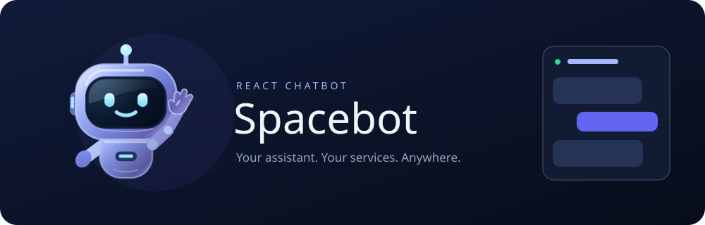
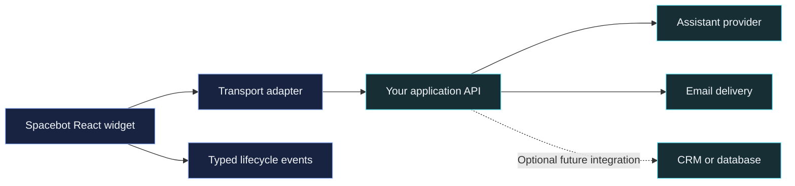

<p align="center">
  
</p>

<p align="center">
  
  
  
  
</p>

<p align="center"><a href="#quick-start">Quick start</a> · <a href="#configuration">Configuration</a> · <a href="#connect-your-services">Integrations</a> · <a href="#development">Development</a></p>

# Spacebot

A configurable React chatbot with an animated robot, streaming responses, optional lead capture, and structured integration events. Bring your own application API; Spacebot handles the interface and conversation lifecycle.

- 🤖 Reusable SVG robot with waving, blinking, and reduced-motion support.
- 🎨 Scoped CSS, configurable placement and copy, and no Tailwind requirement.
- 🔌 Replaceable transports for your assistant, lead intake, and transcript delivery.
- 📦 Typed ESM package, ready to build and install as an npm tarball.

## Quick start

Use Node.js 22.12 or newer to build from source. Consuming applications need React and React DOM 19 and an ESM-capable bundler.

From the Spacebot repository:

```bash
npm ci
npm run build
npm pack
```

This creates `spacebot-0.1.0.tgz`. `npm pack` also runs the build through `prepack`, so packing always refreshes the output. It does not publish anything to a registry.

From your React application:

```bash
npm install /path/to/spacebot-0.1.0.tgz
```

Import the stylesheet once, then render the widget. This first example works without a backend:

```tsx
import { Spacebot } from 'spacebot'
import type { SpacebotTransport } from 'spacebot'
import 'spacebot/styles.css'

const transport: SpacebotTransport = {
  async chat(request, { signal, onEvent }) {
    signal.throwIfAborted()
    onEvent({ type: 'delta', text: `You said: ${request.message}` })
    onEvent({ type: 'done' })
  },
}

export function App() {
  return <Spacebot title="Orbit" subtitle="Your helpful assistant" transport={transport} />
}
```

To explore the included demo, run `npm run dev` from this repository and open the URL printed by Vite. It uses mock responses and makes no service or email requests.

## Configuration

| Prop | Default | Purpose |
| --- | --- | --- |
| `transport` | Required | Chat and optional lead/transcript operations. |
| `title` | `Spacebot` | Header, launcher, and accessible labels. |
| `subtitle` | Hidden | Optional text beneath the title. |
| `greeting` | A greeting using the title | First message in each new conversation. |
| `copy` | Generic English copy | Override prompts, placeholders, status labels, and `leadSuccess(name, canContinue)`. |
| `placement` | Bottom-right | Independent launcher/panel positions and mobile overrides. |
| `open`, `onOpenChange` | Internal state | Control visibility from navigation or contact buttons. |
| `defaultOpen` | `false` | Initial visibility for uncontrolled use. |
| `storage` | `{ key: 'spacebot-session-v1' }` | Same-tab session restoration; use `false` to disable. |
| `maxUserTurns` | No local limit | Optional local cap; the server's remaining-turn count can further restrict it. |
| `closeBehavior` | `minimize` | `minimize` preserves the chat; `end` finishes it. Minimize mode includes a separate end action. |
| `transcriptPolicy` | All triggers disabled | `onEnd`, `onPageHide`, and `requireConsent`. Configure a transcript transport before enabling delivery. |
| `onEvent` | Unset | Receive typed, serializable snapshots and lifecycle events. |
| `className`, `style` | Unset | Scoped customization and theme variables. |

The robot can also be used separately:

```tsx
import { SpacebotRobot } from 'spacebot'

<SpacebotRobot waving style={{ width: 96, height: 96 }} />
```

`SpacebotRobot` accepts `className`, `style`, `waving`, and `reduceMotion`. It is decorative; give an enclosing interactive element an accessible name. System reduced-motion preferences apply unless explicitly overridden.

### Position and theme

Positions are `top-left`, `top-right`, `bottom-left`, `bottom-right`, `center-left`, and `center-right`. Numeric offsets are pixels; strings accept CSS lengths. Center positions apply the vertical offset relative to the viewport midpoint. Mobile overrides apply below 640px; their defaults are bottom-right regardless of desktop placement.

```tsx
<Spacebot
  transport={transport}
  placement={{
    launcher: { position: 'center-left', offsetX: 16 },
    panel: { position: 'bottom-left', offsetX: 24, offsetY: 24 },
    mobile: { panel: { position: 'bottom-right', offsetY: 16 } },
  }}
  style={{
    '--spacebot-accent': '#6366f1',
    '--spacebot-panel-width': '420px',
    '--spacebot-z-index': 100,
  }}
/>
```

Additional theme variables include `--spacebot-accent-hover`, `--spacebot-surface`, `--spacebot-bubble`, `--spacebot-border`, `--spacebot-text`, `--spacebot-muted`, `--spacebot-focus`, `--spacebot-font`, `--spacebot-heading-font`, `--spacebot-panel-height`, `--spacebot-launcher-size`, and `--spacebot-mobile-launcher-size`.

The widget portals into `document.body`; place theme overrides on its `style` or `className`, rather than relying on a wrapper's inherited styles. No fonts are downloaded by the package. Keep offsets inside the viewport. Changing identity props updates the interface; existing messages and your backend's assistant persona remain unchanged. Changing the storage key remounts the conversation. Use a different key for each widget on the same origin.

## Connect your services



Spacebot does not include a server, model provider, business knowledge, or database connector. Your API owns authentication, validation, rate limits, durable delivery, and provider credentials. The component title does not change server-side instructions.

### Existing HTTP and streaming API

```tsx
import { createHttpTransport, Spacebot } from 'spacebot'

const transport = createHttpTransport({
  endpoints: {
    chat: '/api/chat',
    leadIntake: '/api/lead-intake',
    leads: '/api/leads',
    transcripts: '/api/transcripts',
  },
})

<Spacebot
  transport={transport}
  closeBehavior="end"
  transcriptPolicy={{ onEnd: true, onPageHide: true, requireConsent: true }}
/>
```

Endpoint URLs may be relative or absolute. Cross-origin APIs must configure CORS. The adapter supports `credentials`, `headers` (an object or async function), and a custom `fetch`. Keep the transport instance stable. Only browser-appropriate authentication belongs here; never pass provider or database secrets to React props.

All operations use JSON POST requests. Message wire objects contain only `id`, `role`, and `content`; UI-only fields are removed. Standard error responses have `{ code, message }` with a non-success HTTP status.

| Endpoint | Request | Response |
| --- | --- | --- |
| `chat` | `sessionId`, `messageId`, `message`, `history`, optional `leadSubmitted` | SSE `data:` frames carrying `ChatStreamEvent`. |
| `leadIntake` | `sessionId`, `messageId`, `phase`, `message`, optional `name` | `intent`, nullable `name`/`email`, and `reply`. |
| `leads` | `sessionId`, `name`, `email`, `consent: true`, `transcript` | `{ success: true }`. |
| `transcripts` | `sessionId`, `transcript`, optional paired `name`/`email` | `{ success: true, alreadySent?: boolean }`. |

Chat events are `delta`/`replace` with `text`, optional `meta` with turn counts, terminal `done` with optional turn counts/`leadRequired`/`restricted`, or `error` with `code` and `message`. Each stream must finish with `done`; truncated or invalid streams retain the draft for retry. `leadRequired` means the assistant's reply already contains the consent prompt. Without it, reaching a configured turn limit appends the configured consent prompt when lead capture is available.

Lead-intake phases are `confirmingLead`, `collectingName`, and `collectingEmail`. Supported intents are `affirms`, `declines`, `provides_name`, `provides_email`, `provides_both`, `asks_question`, and `off_topic`. Supply both lead-intake and lead-submission operations to enable this flow. The backend must honor the consent conversation when returning an affirmative or contact-providing intent.

### Custom transports and structured events

Implement `SpacebotTransport` to adapt another protocol. Its required `chat(request, { signal, onEvent })` operation returns a promise and emits the events above. Optional operations are `leadIntake`, `submitLead`, `submitTranscript`, and synchronous `queueTranscript`. Pass cancellation through to your service and return `{ success: true }` only after the submission is accepted.

```tsx
import type { SpacebotEvent } from 'spacebot'

function observe(event: SpacebotEvent) {
  if (event.type === 'lead.submitted') {
    const { sessionId, lead, messages } = event.conversation
    // Pass this structured data to application-owned state or a service adapter.
    showSubmission({ sessionId, lead, messages })
  }
}
```

`showSubmission` represents your application callback. Events are `conversation.updated`, `message.completed`, `lead.submitted`, `transcript.delivered`, `transcript.queued`, `conversation.ended`, and `error`. Every event carries a copied `ConversationSnapshot`: session ID, messages, phase, lead details/consent, and optional remaining turns. Message-completion events include the completed message; errors include operation, code, and message.

Observer failures are isolated from delivery state. `conversation.updated` can fire for every streaming chunk, so avoid performing database writes for each update. Durable CRM writes belong in your backend submission operation with server-side idempotency, rather than relying on an observer callback. No structured summaries or CRM-specific field extraction are included.

### Delivery and restoration

Explicit end waits for configured delivery before clearing the session. A failure keeps the transcript and provides a retry action. Empty conversations do not submit transcripts. `onOpenChange` controls visibility only; setting `open={false}` externally does not trigger delivery.

Page-exit delivery is best effort. `transcript.queued` is not confirmation of server acceptance. The HTTP adapter uses same-origin beacon when possible, then keepalive fetch, and declines payloads over 60,000 bytes. Async header providers are not resolved during page exit; use a custom synchronous `queueTranscript` implementation if required. The server must deduplicate repeated attempts using the session identity. No browser-side retry queue or exactly-once guarantee is provided.

Same-tab restoration falls back to memory if storage is unavailable. Invalid sessions are discarded. In-progress operations recover to an idle state; terminal conversations have a new-session action. Rendering on the server produces no widget markup until the client mounts. Frameworks that distinguish client components should render Spacebot inside their client boundary.

## Development

```bash
npm ci
npm run dev
npm run check
npm run build:demo
npm pack --dry-run
```

`check` runs ESLint, TypeScript, mocked behavior/transport tests, and the library build. `build:demo` produces a standalone demo in `demo-dist`; the library build goes to `dist`. Browser checks and live backend acceptance remain separate from automated mock tests.

| Directory | Contents |
| --- | --- |
| `src` | Public React components, conversation state, scoped styles, and transport contracts. |
| `demo` | React demo with a mock transport and no Tailwind dependency. |
| `tests` | Conversation and wire-protocol behavior checks. |
| `docs/assets` | Project-owned README banner. |

To distribute an update, increment the package version, run the checks, and pack again. Consumers should store the versioned tarball in their repository and install it through a relative file dependency, so CI does not need your source checkout. Installing the tarball may fetch its dependencies from npm.

Registry publishing is disabled through `private: true`. A future npm release needs an available package name or scope, ownership, license, and release configuration. The component interface and build pipeline can remain the same.
